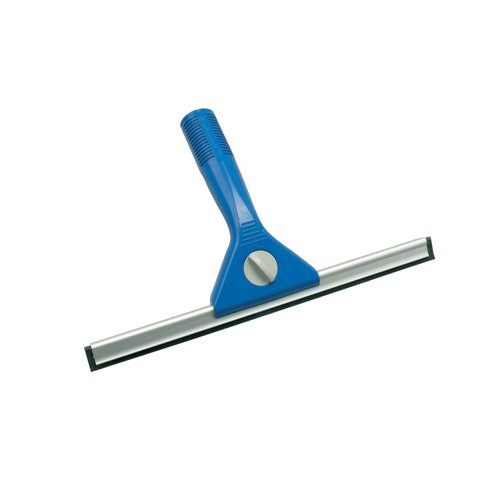

# Squeegee

Clean up an interface that looks AI-generated.

Squeegee is a skill for coding agents. Point it at a page, dashboard or app you already have. It tells you how generated the screen looks, shows you design directions on your own page, and then fixes the theme at its source. Your links, forms, handlers and content keep working.

It is tuned for interfaces a coding agent wrote, with Claude Code, Cursor or Codex, and it also covers pages from AI site builders. Its rules come from measuring both kinds against professionally made work.

It does not build new UI.

**On this page**

- [1. Install](#1-install)
- [2. Run your first audit](#2-run-your-first-audit)
- [3. Review the result](#3-review-the-result)
- [What to try next](#what-to-try-next)
- [How it works](#how-it-works)
- [Options](#options)
- [Questions](#questions)
- [The research behind it](#the-research-behind-it)

## 1. Install

You need a coding agent, a project folder and Node.js 18 or later, which runs the detector and the comparison pages. Rerunning the research also needs Node 22 or later and an installed Chrome.

The easiest way is to ask your agent. Paste this into its chat:

```
Install the Squeegee skill from https://github.com/cablemp5/squeegee using its README, then tell me how to run my first audit.
```

**Prefer to type the commands yourself?** In Claude Code, run:

```
/plugin marketplace add cablemp5/squeegee
/plugin install squeegee@squeegee
```

An agent installing it from a shell can run the same steps as CLI commands:

```
claude plugin marketplace add cablemp5/squeegee
claude plugin install squeegee@squeegee
```

Either way, restart your agent afterward. Installed as a plugin, the command is `/squeegee:squeegee`. Step 2 uses that full form. The later examples use the short form `/squeegee`: if your agent does not find it, type `/squeegee:squeegee` instead.

**Using another agent?** Agents that read skills, such as Cursor or Codex, can install it with:

```
npx skills add cablemp5/squeegee
```

You can also copy the `skills/squeegee` folder into your agent's skills folder.

## 2. Run your first audit

Start with a report. It covers every screen and all 30 UX laws, and nothing in your project changes.

```
/squeegee:squeegee audit app/page.tsx
```

Give it a file, a folder or a URL. With a URL, Squeegee looks at the running page and edits the project that serves it.

## 3. Review the result

The audit rates the screen on a four-step scale.

| Tier | Meaning |
|---|---|
| Spotless | No slop. Squeegee says so and stops. |
| Streaky | Light slop: a defect or a few tells on a design you otherwise chose. |
| Grimy | Heavy slop: five or more stock defaults or tells, or sprawl, which means text sizes a pixel apart, many font weights, small uppercase labels and tiny text. |
| Opaque | Slop maxed: the screen would fit any product. |

Each finding says what it saw, where it lives in your code, why it counts and how to fix it. The reason is a research number, a threshold or a UX law in plain words. The audit stops there. When you're ready, run it again without `audit`. It shows the proposal with design directions, waits for your approval once, and then makes the changes. A Grimy or Opaque screen at `full` or `deep` gets three directions. A Streaky screen, or any `lite` run, gets one direction that keeps your design.

```
/squeegee app/
```

## What to try next

```
/squeegee fix lite components/Hero.tsx
```

Restyles one component without waiting for approval. `lite` limits it to tokens, type, color, spacing and states, so layout stays put.

```
/squeegee deep http://localhost:3000 --ref https://example.com --ref ./moodboard.png
```

Reworks a whole running page and points it toward a site you like. `deep` may also fix structural UX problems.

```
/squeegee audit app/ --no-shots
```

Audits a folder without saving any screenshots.

## How it works

1. It captures the screen at desktop and phone width, in dark mode too when the page has one. For an app with several screens it audits each one. A script measures each screen: text sizes, weights, colors, contrast, target sizes, and fonts that are named but never loaded. A second script fills cards, rows and lists with worst-case content (a long name, one unbroken word, a ten-digit number) in the live page and reports what breaks.
2. A detector scans your code with 20 candidate rules, 9 stock-default checks and 8 measures of one-off styling, such as hard-coded colors and tiny uppercase labels per 1,000 lines. The agent confirms each candidate on screen, answers all 30 UX laws, and weighs the tells that need judgment.
3. It rates the screen Spotless, Streaky, Grimy or Opaque.
4. Without `audit`, it renders directions on your own page so you choose by looking: three for a Grimy or Opaque screen at `full` or `deep`, one that keeps your design for a Streaky screen or a `lite` run. Give it references with `--ref`, as many as you like. It measures each one and builds a single direction from their colors, type and shape, never from their layout or content. Say the references are alternatives and each gets its own direction. Each direction states its choices as numbers and says where each came from. Previews leave no lasting changes. It injects styles into the open page, and when that cannot show a direction it edits files briefly from a backup and restores them.
5. It fixes the page in three passes: theme and tokens, then structure and copy, then motion. After each pass it captures the screen again, runs your typecheck, build and tests, and confirms that every link, field, handler and piece of content still exists.
6. It measures the finished screen against the numbers the chosen direction stated, and reports each one as matched or not. At `full` and `deep`, a fresh agent that never saw the first audit also rates the result and says whether it is the preview you approved. `lite` runs and `--no-recheck` skip the fresh agent.
7. It writes a before and after page and a report that says what passed, what failed and what did not run.

Squeegee runs only when you call it. It never starts on its own and never commits.

## Options

| Argument | What it does |
|---|---|
| `audit` | Report only. |
| `fix` | Apply the fixes without waiting for approval. It stops only to ask for a direction when it has two or more to show and none is saved. When your references make one direction it takes that direction. Changes that need your approval, such as copy edits, are listed in the report and not made. |
| neither | The default. Audit, show the proposal, wait once for approval, then fix. |
| `lite` | Restyle only: tokens, type, color, spacing and states. |
| `full` | May also restructure a section that has a layout tell. |
| `deep` | May rework the page and fix structural UX problems. |
| a path or URL | What to clean. |
| `--ref <url or image>` | A design you want the result to feel like. Repeat it to give several. All of them feed one direction, shown beside one that keeps your design. Say they are alternatives ("either of these") and each gets its own direction, up to three. |
| `--no-shots` | Save no images and build no before and after page or directions page. |
| `--no-recheck` | Skip the blind recheck. |

If you leave out `lite`, `full` and `deep`, Squeegee uses the depth the tier proposes: `lite` for Streaky, `full` for Grimy, `deep` for Opaque. In `fix` mode it goes no further than `full` unless you type `deep`.

## Questions

### Will it delete or invent content?

No. It never adds features, sections, claims, numbers, testimonials, logos or legal text. It never deletes content, metrics, calls to action, pricing tiers or forms. It reorders and reweights what is already there. It asks before changing your brand color, your logo or the meaning of your content.

### Will it just swap in a different template?

No. Removing a gradient does not mean adding grain, and removing a font does not mean picking this year's popular one.

### Does it need a browser?

It works without one, but then it marks every visual result as unverified. With a browser tool it can see and measure the page. It uses the first of these it finds and never installs one itself.

1. Playwright MCP sets exact viewport sizes, switches the color scheme and reads computed styles, so Squeegee can measure contrast and target sizes.
2. Chrome DevTools MCP takes similar captures and also reports console errors.
3. Your agent's own browser can reach screens behind a login with your real session.

For native apps, give it a simulator or device screenshot tool, or screenshots.

### What does it remember between runs?

Your choices go in `.squeegee.md` at the project root: the direction you picked, and anything you told it to keep, with your reason. Later runs read that file and make the same choices. Screenshots and logs go in `.squeegee/`, which git ignores without any setup.

### What can it clean?

| Surface | Audit, tier, directions, judged fixes | Detector and source fixes |
|---|---|---|
| Landing pages, dashboards, web apps (React, Tailwind, shadcn, plain CSS) | Yes | Yes |
| Desktop apps built with web code (Electron, Tauri) | Yes | Yes |
| React Native | Yes, with fewer rules, because the research has no native app screens | Planned |
| SwiftUI, Flutter, WinUI | Yes, with fewer rules | No |

### How finished is it?

This is version 0.3.0. The detector passes its 32 tests. The research has measured 1,257 rendered pages and the source of 503 repo snapshots. One audit has run on a real project, and its misses shaped this version. Nobody has run a full fix pass on a real project yet. The `npx skills add` path and agents other than Claude Code are untested.

## The research behind it

Most lists of AI tells come from opinion. Squeegee's list comes from measurement. A script loaded 565 professionally made sites and 273 pages published from AI site builders, read their computed styles, and counted each signal. These tables compare 282 reference landing pages with 84 AI-built landing pages of similar length.

| | Reference landing pages | AI-built landing pages |
|---|---|---|
| shadcn-style theme variables present | 6% | 87% |
| Lucide icons | 10% | 87% |
| No font chosen | 5% | 24% |
| Headline weight 700 or more | 22% | 67% |
| Badge above the headline | 6% | 35% |
| **Five or more of nine stock defaults** | **2%** | **65%** |

Several signals often called AI tells differed little between the two groups, and some ran the other way.

| | Reference landing pages | AI-built landing pages |
|---|---|---|
| Purple or violet as a main color | 9% | 6% |
| Three equal icon cards in a row | 52% | 45% |
| Bento grid | 25% | 17% |
| Two or more hype words | 36% | 23% |

A cluster of stock defaults marked an AI-built page, and purple did not. So Squeegee counts stock defaults as a group, fixes each one where it is defined, and treats the other signals as things to weigh rather than ban.

### Agent-written projects

Site builders are one source of generated UI. Coding agents such as Claude Code, Cursor and Codex are the other, and their work looks different. A second study found 313 public repos that an agent wrote, each confirmed by agent signatures on its commits or by an agent instruction file, and measured 419 of their live sites. For comparison it read 87 hand-made repos, and 78 of them again as they stood at the end of 2022, before coding agents existed.

| | Reference | Builder | Agent-written |
|---|---|---|---|
| Five or more of nine stock defaults (landing pages) | 2% | 65% | 24% |
| Three or more of four sprawl measures over their limit | 3.6% | not measured | 15.7% |
| More than five small uppercase labels on one page | 10% | 10% | 27% |
| Body text under 16 px (landing pages) | 35% | 63% | 68% |

Agent-written pages carry the builder's stock defaults a quarter of the time. Their own mark is sprawl: styles added one request at a time and never merged. Squeegee counts four things on the rendered screen: pairs of text sizes 1 px apart, which show that no type scale was chosen, small uppercase labels, the share of text under 12 px, and font weights. Three or more over their limit is rare in professional work. Classic hierarchy checks did not help: professional pages skip heading levels and mix heading styles more often than agent-written pages do.

The same habit shows in the source. The detector counts eight densities, such as hard-coded colors, inline styles and tiny uppercase labels per 1,000 lines.

| Source measures over the hand-made limit | Agent-written | Builder | Hand-made today | Hand-made 2022 |
|---|---|---|---|---|
| 3 or more of 8 | 56% | 55% | 4% | 4% |
| 4 or more of 8 | 33% | 27% | 1% | 1% |

The study also removed rules. Dark pages, glass and nested cards looked like agent signals until they were compared with professional developer tools, which use them as often. A rule against several heading styles failed on 56% of professional pages, so it is gone. The worst-case content test broke about 70% of professional pages and agent-written pages alike, so it reports and does not affect the rating.

These numbers are associations in samples, and they do not prove cause. The builder sample is 84 landing pages from four builders. Most agent-written sites are developer tools, the agent label rests on commit signatures and instruction files, and the source limits were set on the same hand-made repos they are compared with. The signals record whether something is present, not whether it is done well. The mobile and desktop reference rows come from product websites, not app screens.

The full tables, the method and its limits are in [research/RESULTS.md](research/RESULTS.md) and [research/AGENT-RESULTS.md](research/AGENT-RESULTS.md). The 565 reference sites are listed in [research/reference-sites.csv](research/reference-sites.csv), the agent-written sites in [research/agent-sites.csv](research/agent-sites.csv), and the repos in [research/bench-repos.csv](research/bench-repos.csv).

### Rerun the research

The defaults AI site builders produce change over time. The capture needs Node 22 or later and an installed Chrome. It has no dependencies and calls no model.

Run these from the repo root, in order. Capture writes `<outDir>/measurements.jsonl` and refuses a folder that already has one, so use a fresh folder each time.

```
node research/find-ai-pages.mjs scratch/ai-sites.csv
node research/capture.mjs research/reference-sites.csv scratch/reference
node research/capture.mjs scratch/ai-sites.csv scratch/ai
node research/analyze.mjs scratch/reference/measurements.jsonl scratch/ai/measurements.jsonl --write research
```

The first line finds new AI-built pages. The two captures measure the reference list, then the AI-built list. The last line compares them and rewrites the files in `research/`.

### Bench the detector on source code

The bench measures source code. It fetches the public repos listed in [research/bench-repos.csv](research/bench-repos.csv), source files only, runs the detector on each, and prints how often every rule and source measure fires in four groups: agent-written, builder-made, hand-made today, and hand-made frozen at the end of 2022. A rule that fires equally in all of them is noise. It needs git, the GitHub CLI and Node 22 or later, and it only reads what it fetches.

```
node research/bench.mjs
```

The repos and the results table go to `scratch/bench/`, about 2 GB for the full list. Add a line to the CSV to test another repo.

### Rerun the agent-written study

```
node research/find-agent-repos.mjs scratch/agent-repos.json
node research/capture.mjs research/agent-sites.csv scratch/agent
node research/compare-pages.mjs scratch/reference/measurements.jsonl scratch/ai/measurements.jsonl scratch/agent/measurements.jsonl
```

The first line searches GitHub for repos a coding agent wrote and keeps the ones that carry agent commit signatures or an agent instruction file. The second measures their live sites. The third compares the three groups of pages.

To recalibrate the skill's own page scripts, capture with `--scripts skills/squeegee/scripts/measure.js,skills/squeegee/scripts/stress.js` and run `node research/compare-measure.mjs <reference.jsonl> <agent.jsonl>`.

### Run the tests

```
node --test skills/squeegee/scripts/detect.test.mjs
```

## Roadmap

- **Comments on directions.** Click an element in a direction preview, type a note, and the agent receives all your notes at once.
- **Unslop replay.** A short video of the old page turning into the new one, with fonts, spacing, images and colors changing in order.
- **React Native detector.** Source fixes for React Native screens.
- **Evaluation suite.** Slopped fixtures go in, Squeegee runs on them, and a blind judge plus the preservation check score the result.

## Credits

Squeegee's structure draws on [unslop](https://github.com/heydamir/unslop), [hallmark](https://github.com/Nutlope/hallmark), [impeccable](https://github.com/pbakaus/impeccable), [taste-skill](https://github.com/leonxlnx/taste-skill), [ui-craft](https://github.com/educlopez/ui-craft), [no-ai-design-slop](https://github.com/mengto/skills) and [design-lab](https://github.com/0xdesign/design-plugin). Its motion values, its motion tells and the idea of its worst-case content test come from [Emil Kowalski's skills](https://github.com/emilkowalski/skills). Its UX law checks follow [Laws of UX](https://lawsofux.com) by Jon Yablonski. This repo copies no text from any of them.

## License

MIT.
